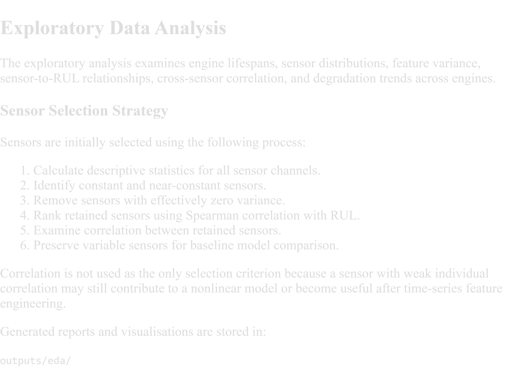

AI-Driven Asset Health and Predictive Maintenance Platform
An explainable artificial intelligence platform for monitoring equipment health, predicting Remaining Useful Life, detecting sensor anomalies, and supporting risk-based maintenance decisions.

Project Overview
Unexpected equipment failures can result in operational disruption, unplanned downtime, safety risks, and significant financial losses.

This project aims to develop an AI-powered decision-support platform that processes operational and sensor data to:

Predict equipment Remaining Useful Life
Estimate failure risk
Detect abnormal sensor behaviour
Calculate equipment health scores
Prioritise maintenance actions
Explain model predictions
Estimate potential maintenance cost impact
Target Industries
Aviation
Automotive
Electronics
Manufacturing
Industrial engineering
Transportation and logistics
Planned Technologies
Python
Streamlit
Pandas
NumPy
Scikit-learn
XGBoost
SHAP
Plotly
GitHub
Planned Platform Modules
Executive Overview
Fleet Health Monitor
Asset Diagnostics
Maintenance Priority Queue
Batch Prediction
Model Performance
Cost Impact Simulator
Current Development Status
The project structure and initial Streamlit interface have been created.

Dataset
The machine-learning pipeline will initially use the NASA C-MAPSS turbofan engine degradation dataset.

Disclaimer
This application is a portfolio demonstration developed using benchmark or simulated data. It is not validated for real-world, safety-critical maintenance decisions.

Dataset
The initial modelling pipeline uses the NASA C-MAPSS FD001 turbofan engine degradation dataset.

FD001 contains:

100 training engine trajectories
100 test engine trajectories
One operating condition
One simulated fault mode
Three operational settings
Twenty-one sensor measurements
The training trajectories continue until simulated failure. Test trajectories end before failure, and separate Remaining Useful Life values are provided for evaluation.

Dataset Attribution
Saxena, A. and Goebel, K. (2008). Turbofan Engine Degradation Simulation Data Set. NASA Ames Prognostics Data Repository, NASA Ames Research Center, Moffett Field, California.

Data Pipeline
The data pipeline:

Loads the original space-separated text files.
Applies a consistent 26-column schema.
Checks missing values and duplicated observations.
Validates engine identifiers and operating-cycle sequences.
Generates Remaining Useful Life targets.
Saves processed data for model development.

